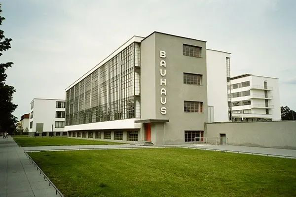
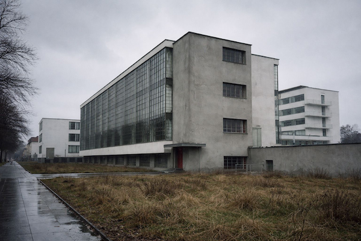
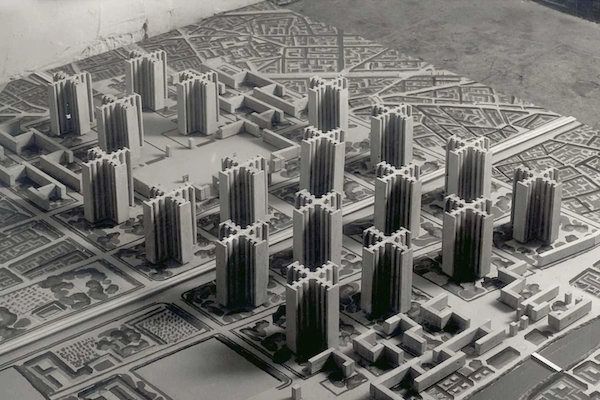

# Form follows function, but what if you got the function wrong?

Lately I've been thinking and reading a bit about architecture. Not *software* architecture. *Actual* architecture. Buildings. In the real physical world.
It's always been a interest of mine, and it was a strong contender on my selection of my bachelors. In particular, the aesthetics of buildings.
Even though I like it as much as anyone else, I don't believe the 19th century was the apex of architecture, like a lot of people online do. But I find it very hard to find modern(ist) examples that I truly like, so it's a bit hard to argue my point.
My dislike of modernist architecture feels even more strange when I consider that I *love* modernist designs elsewhere.
The following article was the result of me thinking about that "contradiction", and was initially meant to be a letter to the editor of the brilliant [Works In Progress Magazine](https://worksinprogress.co/), until I found out that most of my thoughts have been already better expressed in [this](https://worksinprogress.co/issue/machines-for-living-in/) old article of theirs.
Still it was the result of a lot of thought and introspection about a discipline I'm not well versed in, so I wanted to publish it somewhere regardless. I hope you enjoy it.

---

If a designer or architect adheres to the modernist maxim of "Form follows Function", we can infer their idea of the Function from the Form they produced.
Easy enough for tools, furniture or practical objects with a clear and limited number of functions. And as such, modernist industrial design is superb (Dieter Rams and Johnny Ives are my favourite examples).

But what about more complex things? What is the function of a building?
*European* Modernism (the American variety has a distinctly different feel in my opinion) has consistently produced bland and boring brick boxes, and depressing monoliths of grey concrete. Buildings that most people dislike (as per Robert Kwolek's article *"Contrary to Popular Opinion"* in [WIP25](https://worksinprogress.co/)).
The iconic Bauhaus building itself is just one bad winter and a gardeners strike away from looking like a derelict industrial estate:

| Before |                           |
| ------ | ---------------------------------------------------- |
| After  |  |

So what Function can we derive from such Forms?
If modernist architects saw houses as nothing more than *human warehouses*, they would produce exactly that: cheap, sterile, dense storage facilities.
The same would explain the design of modern schools and universities, if you view them merely as "factories" that produce citizens.
And I don't think it's an unfair conclusion, as Le Corbusier himself described a house as *"a machine for living in"*.

Le Corbusier, in particular, held a deeply misanthropic worldview. One must only look at his grotesque plan to replace the centre of Paris with a grid of gigantic concrete towers (*Le Plan Voisin*), and will inevitably conclude that he saw people as little more than interchangeable cogs in the *"Machine of Society"*.
The fact that he worked for both the USSR and Vichy France shouldn't surprise anyone.

But the function of a building is also artistic: to inspire and elevate its surroundings. We used to know that, and that's why we built public buildings, train stations, and even factories that rivalled ancient temples.

I can't really disagree with the idea that form should follow function, but a misunderstood or oversimplified function will produce inadequate and twisted forms.

---

\*Read more about this [here]()
